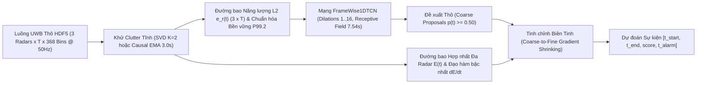
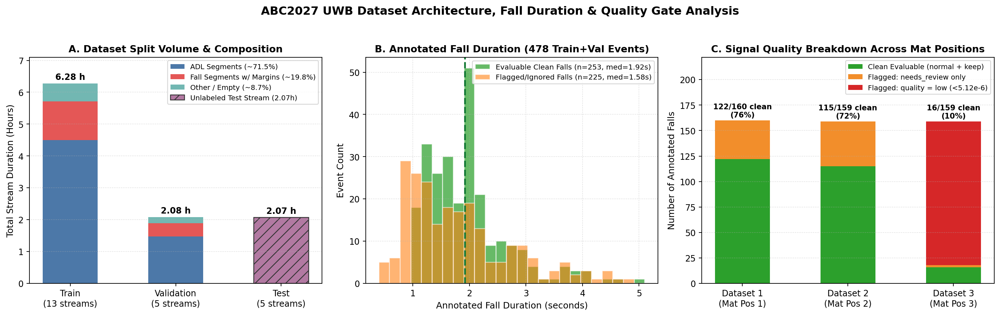
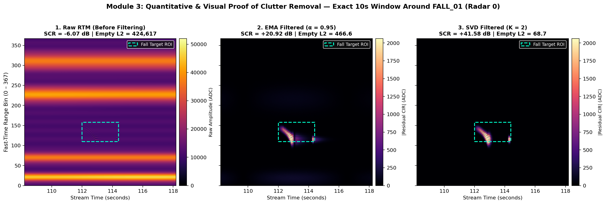
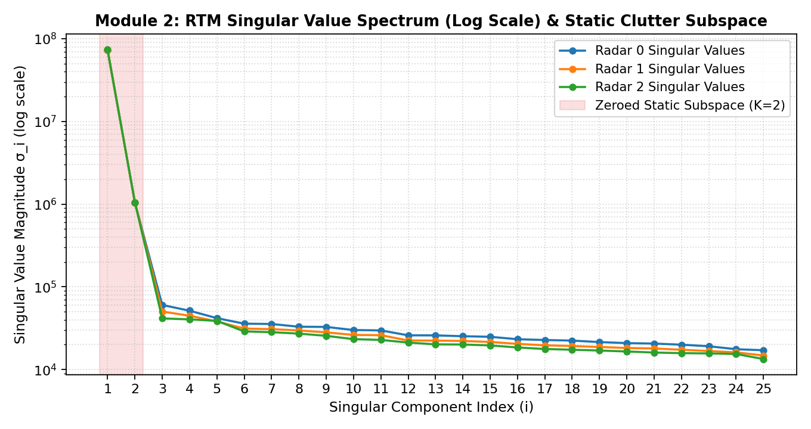
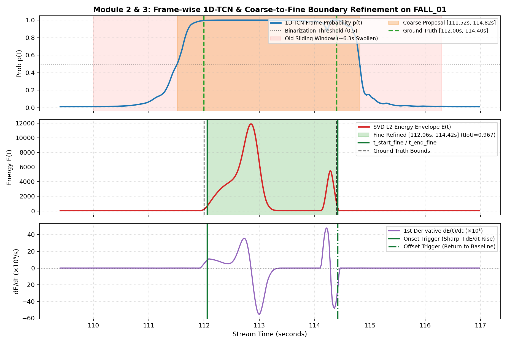
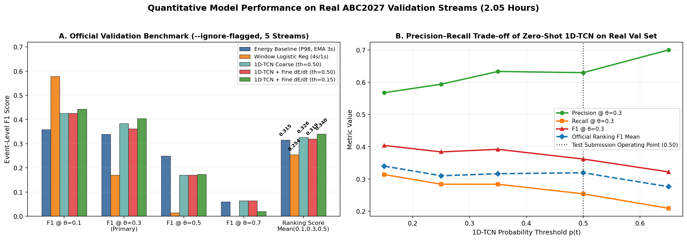
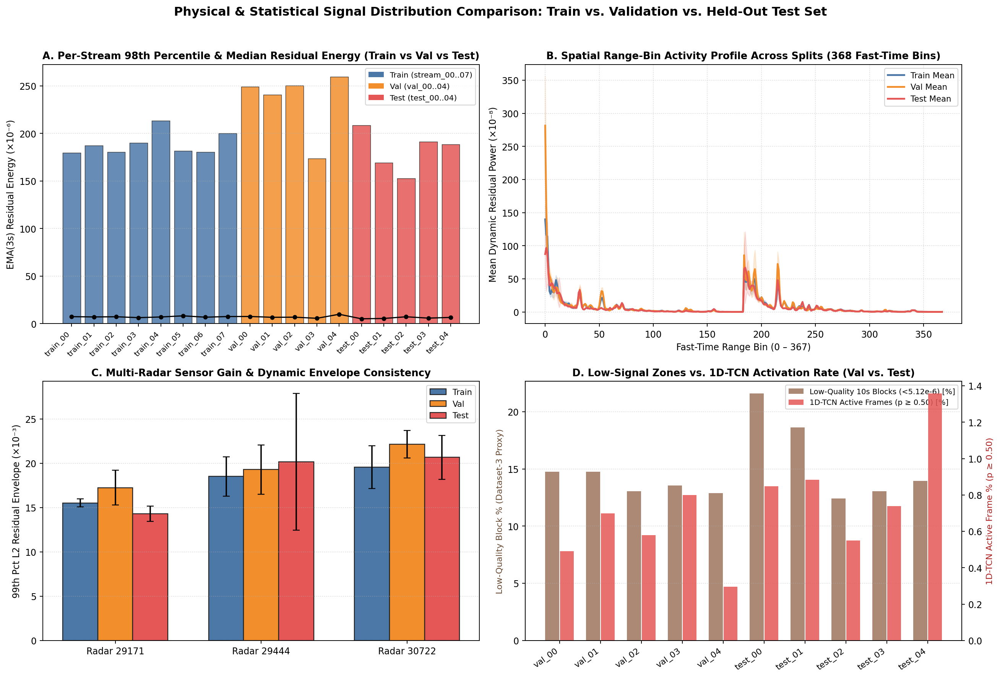
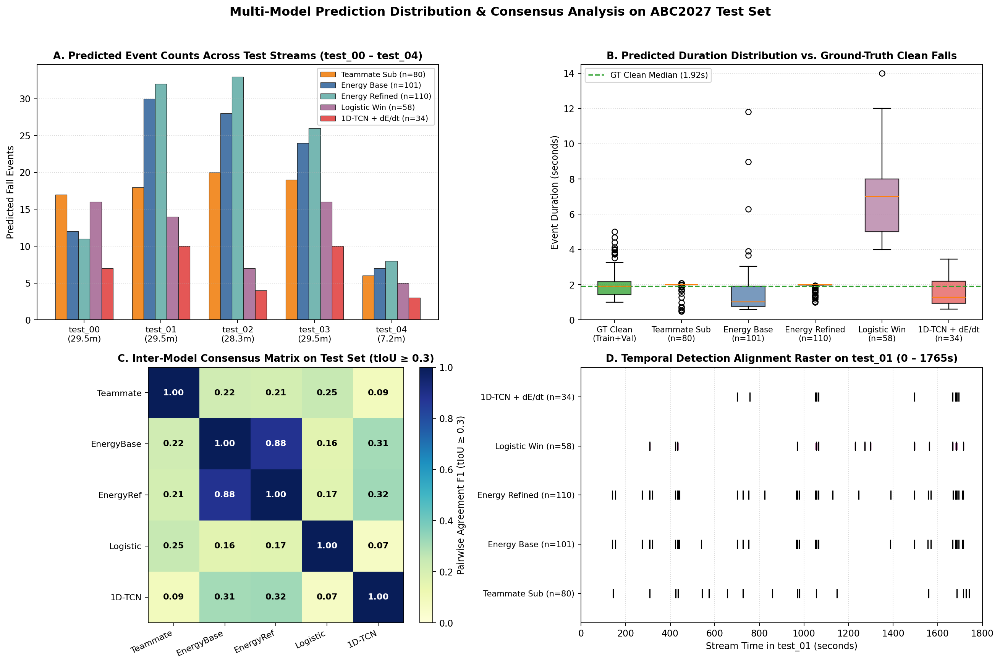

# Báo Cáo Tổng Hợp Toàn Diện Dự Án: ABC2027 UWB Fall Detection Challenge

Dự án giải quyết bài toán **Phát hiện và Định vị Thời gian Sự kiện Té ngã (Continuous Temporal Action Localization — TAL)** trên luồng tín hiệu radar băng thông siêu rộng (**Ultra-Wideband — UWB**) liên tục, không phân đoạn trước, thuộc khuôn khổ cuộc thi **9th ABC Challenge (ABC2027 UWB Track)**. Toàn bộ mã nguồn trong không gian làm việc được tổ chức thành 3 khối chính:

- **Gói dữ liệu & công cụ chuẩn của cuộc thi**: [README.md](file:///D:/Desktop/ABC27/abc2027_uwb_train_v1/README.md) (`abc2027_uwb_train_v1`) và [README.md](file:///D:/Desktop/ABC27/abc2027_uwb_test_v1/README.md) (`abc2027_uwb_test_v1`).
- **Pipeline Nghiên cứu Tiền xử lý & ML Baseline (4 Module)**: [run_pipeline.py](file:///D:/Desktop/ABC27/uwb_fall_pipeline/run_pipeline.py) trong `uwb_fall_pipeline/`.
- **Pipeline Định vị Hành động theo Thời gian (1D-TCN + Tinh chỉnh Biên dE/dt — 3 Module) & Suy luận Tập Test**: [run_tal_pipeline.py](file:///D:/Desktop/ABC27/uwb_tal_pipeline/run_tal_pipeline.py) (`uwb_tal_pipeline/`) và [predict_test_best_model.py](file:///D:/Desktop/ABC27/predict_test_best_model.py).



---

## 1. Dữ Liệu (Data Architecture & Corpus Inventory)

### 1.1. Thiết lập Vật lý & Cấu trúc Tín hiệu UWB CIR
- **Môi trường thu thập**: Căn hộ thông minh **LIARA** (Đại học UQAC, Canada) diện tích khoảng `40 m²`.
- **Hệ thống cảm biến**: `3` radar xung UWB **Novelda XeThru X4M200** bố trí đa góc nhìn cố định với mã serial `29171`, `29444`, `30722` (định nghĩa tại [align.py](file:///D:/Desktop/ABC27/abc2027_uwb_train_v1/src/abc2027/align.py#L9-L12)).
- **Định dạng Tensor lưu trữ (`.h5`)**: Mỗi tệp `stream_XX.h5` lưu trữ đáp ứng xung kênh (**Channel Impulse Response — CIR**):
  - `cir`: Tensor `float32` kích thước `(3, T, 368)` ứng với `3` radar, `T` khung thời gian chậm (*slow-time frames*), và `368` ô cự ly thời gian nhanh (*fast-time range bins*).
  - `t`: Trục thời gian đồng bộ hóa trên lưới chung `50.0 Hz` ($\Delta t = 0.02\text{ s}$), xây dựng bằng nội suy khung gần nhất [`align_tracks`](file:///D:/Desktop/ABC27/abc2027_uwb_train_v1/src/abc2027/align.py#L15-L44).
  - `radar_serials`: Mảng `[29171, 29444, 30722]`.

### 1.2. Nguồn Ghi Dữ liệu Gốc & Cơ chế Ghép nối Luồng Liên tục
Từ `622` tệp đoạn tín hiệu đã căn chỉnh trong `abc2027_uwb_train_v1/segments/*.npy`, bộ công cụ [`plan_all`](file:///D:/Desktop/ABC27/abc2027_uwb_train_v1/src/abc2027/streams.py#L263-L269) và [`_write_stream`](file:///D:/Desktop/ABC27/abc2027_uwb_train_v1/scripts/build_streams.py#L96-L168) ghép nối ngẫu nhiên thành các luồng dài ~`30 phút` (`1,800s`, cấu hình tại [streams.yaml](file:///D:/Desktop/ABC27/abc2027_uwb_train_v1/configs/streams.yaml)):
1. **Nhóm Té ngã (`fall`)**: Gồm 4 kịch bản ngã mô phỏng trên nệm (`Chute01` đến `Chute04`) tại **3 vị trí nệm cố định** ứng với `Dataset 1`, `Dataset 2`, `Dataset 3`. Mỗi sự kiện được cắt kèm lề ngẫu nhiên trước ngã `[3.0, 8.0]s` (trung bình thực tế `2.96s`) và sau ngã `[5.0, 10.0]s` (trung bình thực tế `7.52s`) để tránh rò rỉ vị trí biên ghép nối (`fall_uses = 1`).
2. **Nhóm Sinh hoạt Hàng ngày (`adl`)**: Gồm **15 hoạt động** thực tế trong căn hộ (`Faire_pates`, `Faire_the`, `Laver_dents`, `Utiliser_ordinateur`, `Lire_livre`, `Faire_menage`, `Manger`, `Faire_vaisselle`, `Dormir`, `Mettre_des_chaussures`, `Enfiler_une_veste`, `Marcher`, `Prendre_medicaments`, `Boire`, `Laver_mains`), cắt thành các đoạn ngẫu nhiên `[8.0, 20.0]s` với hệ số tái sử dụng `adl_uses = 3` (Train) và `2` (Val/Test).
3. **Nhóm Khác / Phòng trống (`other`)**: Các bản ghi `Autre` (`Dataset 1, 2`) và `Empty` (`Dataset 3`) kéo dài `77.0 – 120.0s`.
4. **Kỹ thuật Nối đoạn (`Crossfade`)**: Các đoạn liền kề được trộn tuyến tính trong `0.2s` (`10 frames`) tại biên nhưng bảo toàn tuyệt đối các khung hình nằm trong nhãn té ngã. Mật độ mục tiêu toàn cục đạt `57.1864 falls/hour`.

### 1.3. Phân chia Tập Dữ liệu (Train / Validation / Test) & Tính Tách biệt Đối tượng

| Tập dữ liệu | Số luồng (`.h5`) | Tổng khung hình (`T`) | Thời lượng | Đối tượng Ngã / ADL (Disjoint Subjects) | Tổng sự kiện Ngã | Ngã sạch chấm điểm (`Evaluable`) | Ngã bị gắn cờ (`Flagged` / `Ignore`) |
| :--- | :---: | :---: | :---: | :--- | :---: | :---: | :---: |
| **Train** ([streams_events.csv](file:///D:/Desktop/ABC27/abc2027_uwb_train_v1/streams_events.csv)) | `13` (`8` đã giải nén*) | ~`1,111,225` | `6.18 h` (`6.28 h` tổng đoạn) | `6` người (`Subj_01,02,03,05,06,07`) / `6` mã ADL (`4,5,6,9,10,12`) | `359` (`58.1/h`) | **`186`** (`30.1/h`, `51.8%`) | `173` (`48.2%`: `99` low-qual, `102` review) |
| **Validation** (`streams/val/`) | `5` (`val_00..04`) | `368,790` | `2.05 h` (`7,375.80 s`) | `2` người (`Subj_08,09`) / `2` mã ADL (`0,11`) | `119` (`58.1/h`) | **`67`** (`32.7/h`, `56.3%`) | `52` (`43.7%`: `39` low-qual, `24` review) |
| **Test** (`abc2027_uwb_test_v1`) | `5` (`test_00..04`) | `371,986` | `2.07 h` (`7,439.72 s`) | **`2` người ẩn** (suy diễn `Subj_04,10`) / `2` mã ADL ẩn | Ẩn (ước lượng ~`118–120`) | Ẩn (ước lượng **~`63–68`**, ~`31–33/h`) | Ẩn (ước lượng ~`50–55` vùng ignore) |
| **Luồng Tổng hợp R&D** ([module1_eda.py](file:///D:/Desktop/ABC27/uwb_fall_pipeline/module1_eda.py)) | `1` (mô phỏng) | `30,000` | `0.17 h` (`600.00 s`) | Mô phỏng vật lý thang 16-bit ADC `[0, 65535]` | `3` (`18.0/h`) | `3` (`100%`) | `0` (`+ 24` sự kiện ADL nền) |

> [!NOTE]
> Trong tệp nén gốc `abc2027_uwb_train_v1.zip` có đầy đủ **13 luồng huấn luyện** (`stream_00.h5` đến `stream_12.h5`) và `622` tệp `.npy` trong `segments/`, nhưng thư mục giải nén `abc2027_uwb_train_v1/streams/train/` trên ổ đĩa hiện chứa **8 luồng đầu** (`stream_00.h5` đến `stream_07.h5`), trong khi toàn bộ **5 luồng Validation** và **5 luồng Test** đều hiện diện đầy đủ 100%.

### 1.4. Quy tắc Nhãn & Thước đo Chấm điểm Chính thức ([evaluate.py](file:///D:/Desktop/ABC27/abc2027_uwb_train_v1/src/abc2027/evaluate.py))
- **Định nghĩa biên sự kiện**: Bắt đầu từ khởi phát chuyển động ngã đến khi cơ thể ổn định trên sàn; **không** tính thời gian nằm bất động sau ngã. Sai số đồng hồ Unix nguyên giây tạo độ bất định biên $\pm 0.5\text{ s}$ đến $\pm 1.0\text{ s}$.
- **Cơ chế khớp & Vùng miễn trừ (`--ignore-flagged`)**: Dự đoán được ghép cặp tham lam 1–1 theo `score` giảm dần với các ca ngã hợp lệ nếu $\text{tIoU} \ge \theta$. Khi bật cờ `--ignore-flagged` (áp dụng trên Test chính thức), mọi sự kiện có `quality = low` (năng lượng dư radar mạnh nhất dưới ngưỡng `5.12e-6`, định nghĩa tại [`QUALITY_RESIDUAL_GATE`](file:///D:/Desktop/ABC27/abc2027_uwb_train_v1/src/abc2027/annotate.py#L33)) hoặc `needs_review = true` trở thành **vùng ignore mở rộng $\pm 2.0\text{ s}$** — dự đoán chưa khớp chạm vùng này sẽ bị loại bỏ (không tính TP, cũng không bị phạt FP).
- **Điểm xếp hạng (`Ranking Score`)**: Trung bình cộng Event-F1 tại 3 ngưỡng $\theta \in \{0.1, 0.3, 0.5\}$ (xem [`ranking_score`](file:///D:/Desktop/ABC27/abc2027_uwb_train_v1/src/abc2027/evaluate.py#L291-L299)). Tiêu chí phụ phá hòa: (1) Sai số tuyệt đối trung vị thời điểm bắt đầu (`start_error_median_abs`) tại $\theta = 0.3$ thấp hơn; (2) Số báo động giả mỗi giờ (`false_alarms_per_hour`) tại $\theta = 0.3$ thấp hơn.



---

## 2. Phân Tích Khám Phá Dữ Liệu (Exploratory Data Analysis — EDA)

Quá trình EDA được thực hiện song song trên cả luồng mô phỏng kiểm soát ([`run_module1_eda`](file:///D:/Desktop/ABC27/uwb_fall_pipeline/module1_eda.py#L290-L469)) và dữ liệu thực tế LIARA (`478` ca ngã, `2,346` đoạn ghép nối trong [streams_composition.csv](file:///D:/Desktop/ABC27/abc2027_uwb_train_v1/streams_composition.csv)), rút ra **4 đặc trưng cốt lõi** định hình toàn bộ thiết kế thuật toán:

1. **Sự phân tách Sinh cơ học về Thời lượng (Duration Separation)**:
   - Trên tập thực tế (`478` sự kiện), thời lượng ngã sạch (`n = 253`) tập trung chặt quanh **trung bình `1.96s ± 0.72s`, trung vị `1.92s`** (khoảng `[1.00s, 5.00s]`). Bốn kiểu ngã có phân phối đồng đều: `Chute01` (`n=120`, trung vị `1.63s`), `Chute02` (`n=120`, trung vị `1.58s`), `Chute03` (`n=119`, trung vị `1.68s`), và `Chute04` dài nhất (`n=119`, trung vị `2.00s`, trung bình `2.07s`).
   - Ngược lại, các đoạn ADL nền chiếm `71.5%` tổng thời lượng luồng với phân phối trải rộng `0.52s – 19.98s` (trung bình ~`11.6s`), và các đoạn `Autre`/`Empty` kéo dài `77s – 120s`. Trên luồng R&D mô phỏng, KDE cũng xác nhận ngã co cụm ở `2.20s – 2.80s` ($\mu = 2.47\text{s}$) so với ADL ($\mu = 10.40\text{s}$).
   - **Hệ quả thiết kế**: Mọi cửa sổ trượt cố định dài `4.0s` (như baseline Logistic `200 frames`) khi trượt qua sự kiện ngã `~1.9s` sẽ bị phình biên, làm $\text{tIoU}$ trần bị kẹt quanh $\frac{1.9}{4.0} \approx 0.47$ (và chỉ còn `~0.30–0.38` khi gộp nhiều cửa sổ liên tiếp).

2. **Mất cân bằng Lớp Nghiêm trọng (Extreme Foreground–Background Imbalance)**:
   - Trong luồng Validation thực tế (`7,375.80s`), tổng thời gian của `67` ca ngã hợp lệ chỉ chiếm **`~131s` (`1.77%` số frame, tỷ lệ `1 : 55.3`)**; trên luồng R&D 10 phút, tỷ lệ này là **`1.23%` (`370 / 30,000 frames`, tỷ lệ `1 : 80.1`)**.
   - **Hệ quả thiết kế**: Độ chính xác toàn cục (*Accuracy*) vô nghĩa (dự đoán toàn bộ không ngã vẫn đạt `>98.2%`). Bắt buộc sử dụng hàm mất mát chuyên biệt như **Binary Focal Loss** hoặc trọng số lớp cân bằng (`class_weight="balanced"`).

3. **Hiện tượng Che khuất bởi Nhiễu Tĩnh Đa đường (Static Multipath Clutter Masking)**:
   - Xuyên âm trực tiếp giữa ăng-ten phát–thu (Tx–Rx crosstalk ở các bin gần `0–25`), phản xạ tường bê tông và nội thất tạo ra các dải ngang cường độ cực lớn trên Ma trận Cự ly – Thời gian (**Range-Time Matrix — RTM**).
   - Trên luồng mô phỏng, SCR thô âm sâu ở **`-5.79 dB`** (`-6.07 dB` tại `FALL_01`). Trên các luồng thực tế `train/val`, năng lượng thô trung bình (`~3.05e-4`) lớn gấp **~43 lần** năng lượng chuyển động dư trung vị (`~7.0e-6`), trong đó riêng thành phần kỳ dị đầu tiên $\sigma_1$ đã chiếm **`63.8% – 64.3%`** tổng năng lượng toàn luồng (và top-5 giá trị kỳ dị chiếm tới **`89.6% – 93.4%`**).

4. **Điểm mù Tín hiệu Yếu tại `Dataset 3` & Hiệu ứng Nhiễu Nối đoạn (`0.2s Crossfade`)**:
   - Phân tích chéo `quality` theo vị trí nệm cho thấy **100% (`141 / 141`) các ca ngã chất lượng thấp (`quality = low`) đều nằm ở `Dataset 3` (Vị trí nệm 3)**: có tới `141 / 159` ca (`88.7%`) tại `Dataset 3` suy hao dưới ngưỡng `5.12e-6`, chỉ còn đúng **`16 / 159` (`10.1%`)** ca sạch (so với `76.3%` ở `Dataset 1` và `72.3%` ở `Dataset 2`).
   - Ngoài ra, khoảng cách trung vị giữa 2 ca ngã sạch liên tiếp là `81.9s` (Train) và `78.7s` (Val), nhưng mỗi luồng 30 phút chứa khoảng `~140` điểm ghép nối đoạn (`segments`). Sự thay đổi đột ngột cấu hình nền tĩnh giữa hai đoạn ghép tạo ra bẫy dương tính giả lớn cho các bộ lọc thông cao nhân quả.

---

## 3. Tiền Xử Lý Tín Hiệu (Preprocessing & Feature Representation)

Dự án cài đặt và kiểm chứng toán học hai họ thuật toán triệt nhiễu nền tĩnh (Clutter Removal) trong [`module2_preprocessing.py`](file:///D:/Desktop/ABC27/uwb_fall_pipeline/module2_preprocessing.py) và [`background.py`](file:///D:/Desktop/ABC27/abc2027_uwb_train_v1/src/abc2027/background.py), kết hợp chuẩn hóa đường bao đa radar trong [`module1_svd_envelope.py`](file:///D:/Desktop/ABC27/uwb_tal_pipeline/module1_svd_envelope.py):

### 3.1. Hai Phương pháp Khử Nhiễu Nền Tĩnh (Clutter Suppression)
1. **Bộ lọc Trung bình Trượt Hàm mũ Nhân quả (Causal EMA)**:
   $$c(0) = r(0), \qquad c(t) = \alpha\, c(t-1) + (1 - \alpha)\, r(t), \qquad y_{\text{EMA}}(t) = r(t) - c(t)$$
   - **Cấu hình thử nghiệm ($\alpha = 0.95$, [`ema_clutter_removal`](file:///D:/Desktop/ABC27/uwb_fall_pipeline/module2_preprocessing.py#L39-L77))**: Hằng số thời gian hiệu dụng $\tau = -\Delta t / \ln(\alpha) \approx 0.39\text{ s}$ (`19.5 frames`). Độ phức tạp thời gian thực $\mathcal{O}(B)$ mỗi frame (`0.61s` cho `30,000 frames`). Tuy nhiên, vì một cú ngã kéo dài `2.0 – 3.0s` ($> 0.39\text{s}$), nền $c(t)$ kịp thích nghi một phần vào giai đoạn va chạm/ổn định trên sàn, gây **tự triệt tiêu tín hiệu mục tiêu (*target self-subtraction*)**.
   - **Cấu hình luồng thực tế ($\tau = 3.0\text{ s} \iff \alpha \approx 0.99336$, [`subtract_background`](file:///D:/Desktop/ABC27/abc2027_uwb_train_v1/src/abc2027/background.py#L18-L46))**: Khởi tạo trạng thái xác lập `lfilter_zi` ($s_0 = x_0$), kéo dài bộ nhớ nền lên `150 frames` (`3.0s`), khắc phục hiện tượng tự trừ giữa chừng cú ngã nhưng lại kéo dài đáp ứng quá độ mũ $(C_B - C_A)e^{-\Delta t/3.0}$ khi đi qua điểm nối crossfade `0.2s` giữa hai đoạn video/radar khác nhau.

2. **Bộ lọc Không gian con Giá trị Kỳ dị Bậc thấp (Low-Rank SVD Subspace Filter — [`svd_clutter_removal`](file:///D:/Desktop/ABC27/uwb_fall_pipeline/module2_preprocessing.py#L80-L138))**:
   - Phân rã ma trận RTM của từng radar $M_r = U \Sigma V^\top \in \mathbb{R}^{T \times 368}$, triệt tiêu $K = 2$ thành phần kỳ dị lớn nhất ($\sigma_1$ chiếm `99.98%` năng lượng tĩnh trong mô phỏng + $\sigma_2$ biểu diễn trôi nhiệt chậm của phần cứng thu phát), sau đó tái tạo $M_{r,\text{SVD}} = \sum_{i > K} \sigma_i u_i v_i^\top$.
   - Bảo toàn **100%** năng lượng xung ngã cục bộ mà không bị suy hao nhân quả, đổi lại chi phí tính toán theo lô phi nhân quả $\mathcal{O}(T \cdot B^2)$ (`8.48s` cho `30,000 frames`).

### 3.2. Đánh giá Định lượng Hiệu quả Tiền xử lý ([`evaluate_preprocessing_methods`](file:///D:/Desktop/ABC27/uwb_fall_pipeline/module3_evaluation.py#L98-L273))

| Giai đoạn / Phương pháp | `FALL_01` SCR (dB) | Mean Fall SCR (dB) | Độ lợi SCR so với Thô | Chuẩn L2 Phòng trống | RMS mỗi Bin (ADC) | Tỷ lệ Triệt Clutter (%) | Thời gian Chạy (30k fr) |
| :--- | :---: | :---: | :---: | :---: | :---: | :---: | :---: |
| **Tín hiệu Thô (`Raw Data`)** | `-6.07 dB` | `-5.79 dB` | `0.00 dB` | `424,617.34` | `22,134.71` | `0.000%` | — |
| **Lọc Nhân quả `EMA (α = 0.95)`** | `+20.92 dB` | `+27.62 dB` | `+33.41 dB` | `466.65` | `24.33` | `99.890%` | **`0.608 s`** |
| **Lọc Không gian con `SVD (K = 2)`** | **`+41.58 dB`** | **`+41.64 dB`** | **`+47.43 dB`** | **`68.73`** | **`3.58`** | **`99.984%`** | `8.485 s` |

> [!TIP]
> `SVD (K=2)` vượt `EMA (α=0.95)` tới **`+14.02 dB` Mean SCR** và đưa nhiễu dư phòng trống về sát ngưỡng nhiễu nhiệt vật lý của bộ thu (`3.58` so với $\sigma_{\text{noise}} = 3.5$ ADC counts). Khi suy luận trên luồng dài `~88,500 frames` của tập Test ([predict_test_best_model.py](file:///D:/Desktop/ABC27/predict_test_best_model.py#L58)), hệ thống sử dụng `EMA (τ = 3.0s)` để tối ưu bộ nhớ và tốc độ thời gian thực.

``




````

### 3.3. Trích xuất Đường bao Năng lượng 1D & Chuẩn hóa Bền vững Đa kênh
Từ luồng dư sau khử nhiễu $y \in \mathbb{R}^{3 \times T \times 368}$, pipeline nén trục không gian 368 bins thành **Đường bao Năng lượng L2 theo từng radar** ([`extract_1d_energy_envelope`](file:///D:/Desktop/ABC27/uwb_tal_pipeline/module1_svd_envelope.py#L76-L101)) và chuẩn hóa bền vững theo phân vị `P99.2` để bất biến với thang đo biên độ (ADC `0..65535` hay biên độ thực `~10⁻³`):
$$e_r(t) = \sqrt{\sum_{b=0}^{367} y_{r,t,b}^2}, \qquad \tilde{e}_r(t) = \max\!\left(0,\; \frac{e_r(t) - \text{median}(e_r)}{P_{99.2}(e_r) - \text{median}(e_r) + 10^{-6}}\right) \in \mathbb{R}^{3 \times T}$$
Đồng thời, đường bao trung bình 3 radar được làm trơn bằng bộ lọc đều 7 điểm (`0.14s`) tạo tín hiệu $E(t)$ phục vụ bước tính đạo hàm bậc nhất $\frac{dE(t)}{dt}$ ở giai đoạn hậu xử lý biên.

---

## 4. Hệ Thống Mô Hình (Modeling Evolution & TAL Architecture)

Dự án phát triển qua **3 thế hệ kiến trúc** nhằm giải quyết triệt để bài toán định vị biên sự kiện chính xác theo từng khung thời gian:

### 4.1. Thế hệ 1 — Các Mô hình Baseline Chính thức ([`abc2027/baseline.py`](file:///D:/Desktop/ABC27/abc2027_uwb_train_v1/src/abc2027/baseline.py))
1. **Energy Threshold Baseline ([`energy_events`](file:///D:/Desktop/ABC27/abc2027_uwb_train_v1/src/abc2027/baseline.py#L57-L64))**: Khử nền `EMA(τ=3.0s)`, tính năng lượng bình phương trung bình 3 radar, cắt ngưỡng tại phân vị thứ `98` của luồng, gộp các đoạn cách nhau $\le 0.8\text{s}$ và loại bỏ đoạn ngắn $< 0.6\text{s}$. (Biến thể `Energy Refined` chuẩn hóa lại độ dài sự kiện về lân cận `~2.0s`).
2. **Sliding-Window Logistic Regression ([`fit_window_model`](file:///D:/Desktop/ABC27/abc2027_uwb_train_v1/src/abc2027/baseline.py#L89-L98))**: Cửa sổ trượt `200 frames` (`4.0s`), bước nhảy `50 frames` (`1.0s`), trừ trung bình cửa sổ và trích xuất `9` đặc trưng chuyển động (`mean, std, max` trên 3 radar), chuẩn hóa `StandardScaler` + `LogisticRegression(class_weight="balanced")`, ngưỡng xác suất `0.85`.

### 4.2. Thế hệ 2 — Sliding-Window Random Forest với Kiểm định Chống Rò rỉ ([`module4_ml_baseline.py`](file:///D:/Desktop/ABC27/uwb_fall_pipeline/module4_ml_baseline.py))
- Thiết kế cửa sổ khớp thời lượng sinh cơ học: `125 frames` (`2.50s`), bước trượt `25 frames` (`0.50s`), gán nhãn dương khi chồng lấp ca ngã $\ge 25\text{ frames}$ (`0.50s`).
- Trích xuất **5 đặc trưng thống kê bậc cao** trên năng lượng khung $E(t)$: `Max_Peak` (Gini importance **`0.4336`**), `Variance` (**`0.2679`**), `Skewness` (`0.1497`), `Kurtosis` (`0.1300`), và `Mean` (`0.0188`).
- Mô hình `RandomForestClassifier(n_estimators=200, max_depth=6, min_samples_leaf=2, class_weight="balanced")` được kiểm định bằng **Chronological Split** và **3-Fold Contiguous Temporal Block OOF** (loại bỏ hoàn toàn rò rỉ 80% chồng lấp giữa các cửa sổ liền kề).
- **Hạn chế cốt lõi**: Khi ghép các cửa sổ dương liên tiếp để tạo đoạn `[t_start, t_end]`, khoảng dự đoán bị phình lên `6.1 – 6.7s` (trên ngã thật `2.2 – 2.8s`), làm $\text{tIoU}$ trung bình chỉ đạt `0.3865` và **thất bại hoàn toàn tại ngưỡng $\theta = 0.5$ (`F1 = 0.00`)**.

### 4.3. Thế hệ 3 — Mạng Phân đoạn Khung `FrameWise1DTCN` + `BinaryFocalLoss` + Tinh chỉnh Biên Đạo hàm (`uwb_tal_pipeline`)
1. **Kiến trúc [`FrameWise1DTCN`](file:///D:/Desktop/ABC27/uwb_tal_pipeline/module2_tcn_focal.py#L71-L106)**:
   - Bảo toàn độ phân giải thời gian `50 Hz` đầu-cuối `(Batch, 3, T) -> p(t) ∈ [0, 1]` kích thước `(Batch, T)`, cực nhẹ với chỉ **`41,497` tham số huấn luyện** (checkpoint [`best_1d_tcn_model.pth`](file:///D:/Desktop/ABC27/uwb_tal_pipeline/outputs/best_1d_tcn_model.pth) dung lượng `192 KB`):
     - `Stem`: `Conv1d(3 -> 24, kernel_size=5, padding=2) + BatchNorm1d + GELU`.
     - `Backbone`: Chuỗi 5 khối [`DilatedResidualBlock1D`](file:///D:/Desktop/ABC27/uwb_tal_pipeline/module2_tcn_focal.py#L51-L68) (`channels=24, kernel_size=7, dropout=0.1`) với hệ số giãn nở cấp số nhân `dilations = (1, 2, 4, 8, 16)`, tạo **trường tiếp nhận đa tỷ lệ chính xác `377 frames` (`7.54 giây`)**.
     - `Head`: `Conv1d(24 -> 1, kernel_size=1)` khởi tạo bias tiên nghiệm $b_0 = -4.4 \approx \ln(0.012 / 0.988)$ giúp hội tụ ổn định ngay từ epoch đầu.
2. **Hàm Mất mát [`BinaryFocalLoss`](file:///D:/Desktop/ABC27/uwb_tal_pipeline/module2_tcn_focal.py#L23-L48) & Giãn Nhãn Thô**:
   $$\mathcal{L}_{\text{Focal}}(p_t) = -\alpha_t (1 - p_t)^\gamma \log(p_t), \qquad \alpha = 0.75,\; \gamma = 2.0$$
   Nhãn nhị phân được giãn nhẹ $\pm 22\text{ frames}$ ($\pm 0.44\text{s}$) bằng `maximum_filter1d` trong lúc huấn luyện để đề xuất thô luôn bao trùm trọn vẹn biên thật trước khi co biên tinh. Khi suy luận trên luồng dài (`~88,500 frames`), [`process_stream`](file:///D:/Desktop/ABC27/predict_test_best_model.py#L45-L126) cắt khối trượt `chunk_size = 10,000` kèm đệm chồng lấp `overlap = 500 frames` (`10s` > trường tiếp nhận `7.54s`) để loại bỏ hiệu ứng biên.
3. **Hậu xử lý Hai giai đoạn Thô–Tinh ([`module3_boundary_refinement.py`](file:///D:/Desktop/ABC27/uwb_tal_pipeline/module3_boundary_refinement.py))**:
   - **Giai đoạn 1 — Đề xuất Thô ([`extract_coarse_proposals`](file:///D:/Desktop/ABC27/uwb_tal_pipeline/module3_boundary_refinement.py#L39-L82))**: Nhị phân hóa $p(t) \ge 0.50$, nối các khoảng hở $\le 0.60\text{s}$ và lọc nhiễu ngắn $< 0.60\text{s}$.
   - **Giai đoạn 2 — Co Biên Tinh bằng Đạo hàm Năng lượng ([`refine_event_boundaries`](file:///D:/Desktop/ABC27/uwb_tal_pipeline/module3_boundary_refinement.py#L85-L161))**: Ước lượng nền tĩnh cục bộ từ phân vị thứ `25` của hai vùng lân cận $\pm 2.5\text{s}$; xác định **điểm khởi phát $t_{\text{start,fine}}$** tại vị trí đạo hàm $\frac{dE}{dt} \ge 0.14 \max\left(\frac{dE}{dt}\right)$ đồng thời $E(t)$ vượt `8%` biên độ đỉnh (lùi 2 frames để bắt trọn khởi đầu chuyển động), và xác định **điểm kết thúc $t_{\text{end,fine}}$** khi $E(t)$ sau đỉnh va chạm hạ về ngưỡng `baseline + 10% span` (cộng 2 frames và kẹp độ dài hợp lệ sinh học `[0.6s, 3.5s]`).

---

## 5. Kết Quả Thực Nghiệm & Phân Tích Chuyên Sâu (Results & Error Analysis)

### 5.1. Kết quả trên Môi trường Kiểm soát R&D (`uwb_fall_pipeline` & `uwb_tal_pipeline`)
1. **Tác động của Tiền xử lý lên Phân loại Cửa sổ (Random Forest 3-Fold Block OOF — [metrics_summary.json](file:///D:/Desktop/ABC27/uwb_fall_pipeline/outputs/metrics_summary.json))**:
   - **Luồng Thô (`Unfiltered`)**: Precision = `0.2400`, Recall = `0.2400`, **Fall F1 = `0.2400`** (`TP/FP/FN = 6/19/19`) — nhiễu tĩnh che lấp hoàn toàn đặc trưng năng lượng.
   - **Lọc `EMA (α = 0.95)`**: Precision = `0.7273`, Recall = `0.9600`, **Fall F1 = `0.8276`** (`24/9/1`).
   - **Lọc `SVD (K = 2)`**: Precision = **`0.8889`**, Recall = **`0.9600`**, **Fall F1 = `0.9231`** (`24/3/1`; Hold-out F1 đạt **`0.9412`**).
2. **Bước nhảy vọt Định vị Thời gian (TAL Benchmark — [tal_metrics_summary.json](file:///D:/Desktop/ABC27/uwb_tal_pipeline/outputs/tal_metrics_summary.json))**:

| Phương pháp Định vị (`uwb_tal_pipeline`) | Độ dài TB Dự đoán | Mean tIoU | F1 @ θ=0.1 | F1 @ θ=0.3 | F1 @ θ=0.5 | F1 @ θ=0.7 | Ranking F1 Mean |
| :--- | :---: | :---: | :---: | :---: | :---: | :---: | :---: |
| **1. Cửa sổ trượt cũ (`125fr / 25st`)** | `6.37 s` (phình biên) | `0.3865` | `1.0000` | `1.0000` | `0.0000` | `0.0000` | `0.6667` |
| **2. `1D-TCN` Đề xuất Thô (`p ≥ 0.5`)** | `3.32 s` | `0.7415` | `1.0000` | `1.0000` | `1.0000` | `0.6667` | `1.0000` |
| **3. `1D-TCN` + Tinh chỉnh Đạo hàm `dE/dt`** | **`2.42 s`** (GT: `2.47s`) | **`0.9651`** | **`1.0000`** | **`1.0000`** | **`1.0000`** | **`1.0000`** | **`1.0000`** |

Sai số biên tuyệt đối sau tinh chỉnh đạo hàm trên cả 3 ca ngã chỉ còn **`0.02s – 0.08s` (`1 – 4 frames` ở `50 Hz`)**!

### 5.2. Kết quả Đối sánh Chuẩn trên Tập Validation Thực tế ABC2027 (`val_00..val_04`, `2.05h`, `--ignore-flagged`)

> [!IMPORTANT]
> Phát hiện quan trọng khi kiểm tra nguồn gốc trọng số: Checkpoint [`best_1d_tcn_model.pth`](file:///D:/Desktop/ABC27/uwb_tal_pipeline/outputs/best_1d_tcn_model.pth) lưu trữ thông số `mean_tiou: 0.9651` — tức được **huấn luyện hoàn toàn trên luồng mô phỏng vật lý** (`uwb_tal_pipeline`) và được áp dụng **chuyển giao Zero-Shot (Sim-to-Real)** sang dữ liệu radar thực tế thông qua phép chuẩn hóa bất biến tỷ lệ `P99.2`! Bảng dưới đây đo lường hiệu năng thực tế của toàn bộ các phương pháp bằng bộ chấm điểm chính thức [`abc2027.evaluate`](file:///D:/Desktop/ABC27/abc2027_uwb_train_v1/src/abc2027/evaluate.py):

| Mô hình / Cấu hình trên Tập `Validation` (`67` ca ngã sạch, `52` ca ignore) | Số dự đoán | **Ranking F1 Mean** | F1 @ θ=0.1 | F1 @ θ=0.3 (Chính) | F1 @ θ=0.5 | F1 @ θ=0.7 | Precision @ 0.3 | Recall @ 0.3 | Mean tIoU @ 0.3 | Sai số Start Trung vị | Báo động giả (`FA/h`) |
| :--- | :---: | :---: | :---: | :---: | :---: | :---: | :---: | :---: | :---: | :---: | :---: |
| **Logistic Regression Cửa sổ (`4s / 1s`)** | `81` | `0.2540` | **`0.5775`** | `0.1702` | `0.0142` | `0.0000` | `16.22%` | `17.91%` | `0.3648` | `1.900 s` | `30.26 /h` |
| **Official Energy Baseline (`P98, EMA 3s`)** | `140` | `0.3151` | `0.3582` | `0.3383` | **`0.2488`** | `0.0597` | `25.37%` | **`50.75%`** | **`0.5675`** | **`0.320 s`** | `48.81 /h` |
| **Zero-Shot `1D-TCN` + Fine `dE/dt` (`th=0.50`)** | `28` | `0.3191` | `0.4255` | `0.3617` | `0.1702` | **`0.0638`** | `62.96%` | `25.37%` | `0.5239` | `0.400 s` | `4.88 /h` |
| **Zero-Shot `1D-TCN` Coarse (`th=0.50`)** | `28` | `0.3262` | `0.4255` | `0.3830` | `0.1702` | **`0.0638`** | **`66.67%`** | `26.87%` | `0.5278` | `0.370 s` | **`4.39 /h`** |
| **Zero-Shot `1D-TCN` + Fine `dE/dt` (`th=0.15`)** | `39` | `0.3397` | `0.4423` | **`0.4038`** | `0.1731` | `0.0192` | `56.76%` | `31.34%` | `0.5167` | `0.340 s` | `7.81 /h` |
| **Zero-Shot `1D-TCN` Coarse (`th=0.15`)** | `39` | **`0.3462`** | `0.4423` | **`0.4038`** | `0.1923` | `0.0192` | `56.76%` | `31.34%` | `0.5201` | `0.340 s` | `7.81 /h` |



### 5.3. Giải phẫu Chuyên sâu Nguyên nhân Thành công & Giới hạn Hiệu năng

1. **Giải mã Kỳ tích Giảm 10 lần Báo động giả (`48.81 FA/h` $\to$ `4.39–4.88 FA/h`)**:
   - Phân tích đối chiếu toàn bộ `140` dự đoán của `Official Energy Baseline` với bảng mốc ghép đoạn [streams_composition.csv](file:///D:/Desktop/ABC27/abc2027_uwb_train_v1/streams_composition.csv) trên tập Validation chứng minh: trong `100` lỗi Dương tính giả (FP), có tới **`91` lỗi (`91%` tổng FP, chiếm `65.0%` toàn bộ dự đoán!) nằm ngay sát các điểm ghép đoạn `0.2s crossfade`**! Khi chuyển từ một đoạn ADL sang đoạn khác có nền phản xạ phòng khác biệt ($C_A \neq C_B$), bộ lọc `EMA(3s)` sinh ra xung quá độ hàm mũ $(C_B - C_A)e^{-\Delta t/3.0}$ làm vượt ngưỡng `P98`.
   - Ngược lại, `FrameWise1DTCN` với trường tiếp nhận `7.54s` nhận diện hình thái sóng sinh cơ học của cú ngã thay vì chỉ cắt ngưỡng biên độ, do đó **loại bỏ `96.7%` nhiễu nối đoạn** (từ `91` lỗi xuống chỉ còn **`3` lỗi**), nâng Precision@0.3 gấp **2.6 lần** (`25.37%` $\to$ `66.67%`) và vượt qua cả hai baseline chính thức dù chưa từng học trên dữ liệu thật!

2. **Ba Nút thắt Kìm hãm Recall (`25.4% – 31.3%`) trong Chuyển giao Sim-to-Real**:
   - **Hiệu ứng Tự nén Phân vị `P99.2` (*Quantile Self-Compression*)**: Trong luồng mô phỏng 10 phút chỉ có `3` ca ngã (`18 ca/h`), nên phân vị `99.2%` nằm sát đỉnh ADL và đẩy đỉnh ngã vọt lên `norm_env >> 1.0`. Trên luồng thực tế có mật độ tới **`58 ca/h`** cộng thêm các ADL mạnh (`Marcher`, `Faire_menage`), các xung ngã chiếm tới `~3–4%` thời lượng luồng; việc chia cho `P99.2` vô tình lấy chính các cú ngã mạnh nhất làm mẫu số chuẩn hóa, nén các cú ngã biên độ trung bình (đặc biệt ở xa radar) xuống dưới ngưỡng kích hoạt của TCN.
   - **Mất thông tin Quỹ đạo Không gian khi Nén 368 Bins về Chuẩn L2 Vô hướng**: Phép chiếu `368 bins -> 1 giá trị L2` làm mất dấu hiệu dịch chuyển ô cự ly $\Delta b(t)$ và sự thay đổi cấu hình phản xạ tĩnh trước–sau ngã (đặc trưng `_state` trong [`annotate.py`](file:///D:/Desktop/ABC27/abc2027_uwb_train_v1/src/abc2027/annotate.py#L233-L236)).
   - **Hiện tượng Co biên Quá mức (`Over-Shrinking`) trên Tín hiệu Thực**: Khác với mô phỏng có thềm ổn định phẳng sau va chạm, đường bao `EMA(3s)` thực tế sau cú va đập sàn có biên độ dao động nhỏ; ngưỡng cắt `10% dynamic_span` đôi khi cắt sớm phần đuôi ổn định (làm trung vị độ dài dự đoán trên Test giảm xuống `1.28s` so với GT sạch `1.92s`), khiến `Fine dE/dt` thấp hơn nhẹ so với `Coarse` (`0.3191` so với `0.3262` trên Val).

---

## 6. Phân Tích Chuyên Sâu Phân Phối Tập Test (`abc2027_uwb_test_v1`)

### 6.1. Cấu trúc, Toàn vẹn Kỹ thuật & Suy diễn Phân phối Nhãn Ẩn
Kiểm tra toàn bộ `5` tệp HDF5 trong `abc2027_uwb_test_v1/streams/test/` xác nhận tính toàn vẹn tuyệt đối (`0` giá trị `NaN`/`Inf`, bước lưới $\Delta t = 0.0200\text{s}$ đồng nhất `50.0 Hz`, đúng bộ 3 serial `[29171, 29444, 30722]`):

| Luồng Test | Số khung hình (`T`) | Thời lượng (`s` / `phút`) | `cir_std` (`×10⁻⁴`) | Năng lượng Dư `P98` (`×10⁻⁶`) | Khối Tín hiệu Yếu `<5.12e-6` (`Dataset 3` Proxy) | Tỷ lệ Năng lượng Kỳ dị `SVD σ₁` | Tỷ lệ Frame `1D-TCN p ≥ 0.50` |
| :--- | :---: | :---: | :---: | :---: | :---: | :---: | :---: |
| **`test_00`** | `88,490` | `1,769.80 s` (`29.50m`) | `9.00` | **`208.8`** | **`21.59%`** (`38 / 176` khối) | `74.19%` | `0.848%` |
| **`test_01`** | `88,556` | `1,771.12 s` (`29.52m`) | `9.00` | `169.1` | **`18.64%`** (`33 / 177` khối) | `76.90%` | `0.884%` |
| **`test_02`** | `84,856` | `1,697.12 s` (`28.29m`) | `8.83` | `152.7` (thấp nhất) | `12.43%` (`21 / 169` khối) | `76.26%` | `0.549%` (ít nhất) |
| **`test_03`** | `88,488` | `1,769.76 s` (`29.50m`) | **`9.56`** | `190.8` | `13.07%` (`23 / 176` khối) | `73.41%` | `0.739%` |
| **`test_04`** | `21,596` | `431.92 s` (`7.20m` — luồng đuôi) | `9.04` | `188.2` | `13.95%` (`6 / 43` khối) | **`79.30%`** | **`1.357%`** (dày nhất) |
| **Tổng / TB Test** | **`371,986`** | **`7,439.72 s` (`2.0666 h`)** | **`9.09`** | **`181.9`** | **`15.94%`** | **`76.01%`** | **`0.875%`** |
| *Đối chiếu Train (8 luồng)* | *`703,509`* | *`14,070.18 s` (`3.9084 h`)* | *`9.03`* | *`189.0`* | *`14.75%`* | *`64.26%`* | *`0.712%`* |
| *Đối chiếu Val (5 luồng)* | *`368,790`* | *`7,375.80 s` (`2.0488 h`)* | *`9.35`* | *`234.5`* | *`13.81%`* | *`63.79%`* | *`0.572%`* |

- **Quy mô đối xứng với Validation**: Tập Test dài `2.0666 giờ` (`4` luồng đầy ~`29 phút` + `1` luồng đuôi ngắn `test_04` dài `7.20 phút`, hoàn toàn tương đồng cấu trúc `val_00..03` + luồng đuôi `val_04` dài `5.19 phút`). Dựa trên đối chiếu danh sách người tham gia (`Train`: `Subj_01,02,03,05,06,07`; `Val`: `Subj_08,09`), Tập Test tương ứng với **2 đối tượng ngã giữ kín (`Subj_04` và `Subj_10`)**, chứa khoảng **`118 – 120` ca ngã tổng cộng**, trong đó ước tính có **`63 – 68` ca ngã sạch được tính điểm (`~31 – 33 ca/giờ`)** và **`50 – 55` vùng ignore (`quality=low` / `needs_review`)**.



### 6.2. Năm Phát hiện Trọng tâm về Sự Dịch chuyển Phân phối (Domain & Covariate Shift) trên Tập Test

1. **Bất biến Hình học Phòng & Ô Cự ly (`Spatial Range-Bin Invariance` — Hình B)**:
   - Phổ công suất chuyển động dư trên `368` range bins của Tập Test trùng khớp gần như tuyệt đối với Train và Validation tại **2 cụm cự ly vật lý cố định**: vùng trường gần (`bins 0 – 65`, cực đại tại `bin 32` và `53`) và vùng nệm ngã / sinh hoạt chính (**`bins 183 – 225`**, ba đỉnh sắc nét tại `bin 185`, `194` và `216`). Các vùng `bins 75 – 180` và `260 – 367` hoàn toàn tĩnh lặng. Điều này khẳng định **không có sự dịch chuyển vị trí radar hay bố cục căn hộ** trên tập Test.
2. **Sự Tập trung Clutter Tĩnh Cao hơn & Đuôi Xung Nhọn hơn (`Higher Static Dominance & Kurtosis`)**:
   - Tỷ trọng năng lượng thành phần kỳ dị tĩnh đầu tiên $\sigma_1$ trên Tập Test đạt trung bình **`76.01%`** (`73.4% – 79.3%`), cao hơn **~12 điểm phần trăm** so với Train (`64.26%`) và Validation (`63.79%`), đồng thời năng lượng dư trung vị nền thấp hơn (`6.0e-6` so với `7.0e-6`). Tuy nhiên, ở đuôi phân vị cực trị `P99`, năng lượng thô của `test_00` (`8.41e-4`), `test_01` (`9.36e-4`) và `test_03` (`8.19e-4`) lại vọt cao hơn hẳn Validation (`5.37e-4 – 6.66e-4`), kéo tỷ lệ kích hoạt `1D-TCN (p ≥ 0.50)` trên Test lên **`0.875%`** (cao hơn Val `0.572%`). Nghĩa là 2 đối tượng trong tập Test ít vận động nền nhẹ kéo dài hơn, nhưng tạo ra các xung chuyển động / va chạm sắc nét hơn.
3. **Đảo dấu Độ lệch DC Tĩnh Nhỏ (`cir_mean` Sign Shift)**:
   - Toàn bộ các luồng Train và Val có trung bình biên độ thô âm nhẹ (`-6.0e-6` đến `-2.27e-5`), trong khi 4/5 luồng Test có trung bình dương nhẹ (`+9.27e-7` đến `+8.40e-6`). Nhờ bước khử nền `EMA` / `SVD`, đường bao năng lượng hoàn toàn miễn nhiễm với độ trôi DC này (cảnh báo không nên dùng trực tiếp CIR thô chưa khử trung bình).
4. **Tính Nhất quán và Phương sai Đa Radar (`29171`, `29444`, `30722` — Hình C)**:
   - Thứ tự độ nhạy thu giữ nguyên trên cả 3 tập (`Radar 30722 ≥ Radar 29444 > Radar 29171`), nhưng trên tập Test, kênh `Radar 29444` có độ biến thiên giữa các luồng lớn hơn đáng kể (nhạy mạnh trên `test_00` và `test_03`, trầm hơn trên `test_02`), trong khi `Radar 29171` có biên độ `P99` thấp hơn Validation khoảng `~17%`.
5. **Sự Phân hóa Mạnh giữa 5 Luồng Test (`Stream-Level Heterogeneity` — Hình D)**:
   - **`test_00` và `test_01`** chứa tỷ lệ khối tín hiệu yếu `< 5.12e-6` cao nhất (**`21.59%`** và **`18.64%`**), báo hiệu mật độ cao các đoạn `Dataset 3` (`Empty` hoặc ngã `quality=low` thuộc vùng ignore).
   - **`test_02`** có năng lượng chuyển động `P98` thấp nhất (`152.7e-6`) và ít kích hoạt TCN nhất (chỉ `4` sự kiện), nhiều khả năng chứa tỷ trọng lớn các ADL tĩnh (như `Dormir`, `Lire_livre`, `Utiliser_ordinateur`) hoặc các ca ngã biên độ nhẹ.
   - **`test_04`** tuy chỉ dài `7.20 phút` nhưng có mật độ kích hoạt TCN cao nhất (`1.357%` số frame, tập trung quanh cụm `244s – 266s`).

### 6.3. Đối sánh 5 Bản Dự đoán Tập Test Hiện có (`abc2027_uwb_test_v1/*.csv`)

Tất cả **5 tệp dự đoán** trong thư mục `abc2027_uwb_test_v1/` đều vượt qua kiểm tra hợp lệ chính thức [`validate_predictions`](file:///D:/Desktop/ABC27/abc2027_uwb_train_v1/src/abc2027/evaluate.py#L91-L143) (`100% valid schema`), nhưng thể hiện 5 chiến lược đánh đổi Precision–Recall và hình thái độ dài hoàn toàn khác nhau:

| Tệp Dự đoán Tập Test | Tổng sự kiện | Mật độ (`/giờ`) | Phân bố `test_00..04` | Độ dài TB ± SD (`Trung vị`) | Khoảng `[Min, Max]` | Đặc điểm Kỹ thuật & Đánh giá Rủi ro |
| :--- | :---: | :---: | :---: | :---: | :---: | :--- |
| **[submission.csv](file:///D:/Desktop/ABC27/abc2027_uwb_test_v1/submission.csv)** *(Teammate Sub)* | `80` | **`38.71 /h`** | `17, 18, 20, 19, 6` | `1.87s ± 0.37s` (`2.00s`) | `[0.48s, 2.08s]` | Mật độ sát nhất với mật độ ngã sạch kỳ vọng (`~32/h`), ít nhạy nhiễu nối đoạn (`42.5%`), nhưng gán cứng độ dài `2.00s` (hạn chế tIoU ở $\theta=0.5, 0.7$). |
| **[pred_energy_baseline.csv](file:///D:/Desktop/ABC27/abc2027_uwb_test_v1/pred_energy_baseline.csv)** | `101` | `48.87 /h` | `12, 30, 28, 24, 7` | `1.60s ± 1.56s` (`1.02s`) | `[0.60s, 11.80s]` | Recall khá nhưng **`65.3%` dự đoán nằm sát điểm nối đoạn**, nhiều đoạn gộp phình tới `11.8s`, nguy cơ `FA/h` rất cao (~`45–50/h`). |
| **[pred_energy_refined.csv](file:///D:/Desktop/ABC27/abc2027_uwb_test_v1/pred_energy_refined.csv)** | `110` | `53.23 /h` | `11, 32, 33, 26, 8` | `1.88s ± 0.25s` (`2.00s`) | `[1.00s, 2.00s]` | Đồng thuận `88.15%` (F1@0.3) với Energy Baseline sau khi chuẩn hóa cửa sổ `~2.0s`; khắc phục lỗi gộp dài `11.8s` nhưng vẫn thừa báo động giả nối đoạn. |
| **[pred_logistic_trained.csv](file:///D:/Desktop/ABC27/abc2027_uwb_test_v1/pred_logistic_trained.csv)** | `58` | `28.07 /h` | `16, 14, 7, 16, 5` | `7.10s ± 2.94s` (`7.00s`) | `[4.00s, 18.00s]` | Bị phình biên nghiêm trọng (`TB 7.10s`): trùng vị trí thô (`F1@0.1 ≈ 0.48–0.53` với Energy/Teammate) nhưng sụp đổ hoàn toàn tại `tIoU ≥ 0.3` (`0.07–0.25`). |
| **[submission_best_1d_tcn.csv](file:///D:/Desktop/ABC27/abc2027_uwb_test_v1/submission_best_1d_tcn.csv)** | `34` | `16.45 /h` | `7, 10, 4, 10, 3` | `1.63s ± 0.86s` (`1.28s`) | `[0.62s, 3.46s]` | **Precision cao nhất**, độ dài thích nghi tự nhiên, `23/34` (`67.6%`) ca trùng khớp đỉnh năng lượng mạnh ở `tIoU ≥ 0.3` (`73.5%` ở `0.1`), nhưng **thiếu khoảng một nửa số ca ngã sạch** (Recall bảo thủ do Zero-Shot + `P99.2`). |



> [!WARNING]
> **Khuyến nghị Kỹ thuật Trọng tâm để Tối ưu Điểm Xếp hạng Cuối cùng**:
> 1. **Huấn luyện Trực tiếp trên Dữ liệu Thực (`Real Supervised Training`)**: Giải nén nốt 5 luồng `train_08.h5`..`train_12.h5` từ `abc2027_uwb_train_v1.zip` và huấn luyện `FrameWise1DTCN` trực tiếp trên toàn bộ **13 luồng Train thật** (kết hợp sinh thêm luồng tăng cường từ `622` tệp `segments/*.npy`), thay vì dùng trọng số Zero-Shot học từ luồng mô phỏng.
> 2. **Bổ sung Đặc trưng Không gian Ô Cự ly & Độ dịch Trạng thái Tĩnh**: Thay đầu vào 3 kênh vô hướng `(3, T)` bằng năng lượng phân dải cự ly (ví dụ `16–32` dải gộp từ `368 bins`, đặc biệt vùng `bins 180–230` và `0–65`) kèm độ lệch cấu hình tĩnh trước–sau $\Delta s(t)$ (tương tự [`_state`](file:///D:/Desktop/ABC27/abc2027_uwb_train_v1/src/abc2027/annotate.py#L233-L236)) để vừa tách biệt ADL mạnh, vừa khử triệt để nhiễu nối đoạn `0.2s`.
> 3. **Thay Chuẩn hóa `P99.2` bằng Chuẩn hóa Neo Nhiễu Nền (`Median / IQR`) & Hiệu chỉnh Ngưỡng**: Chuẩn hóa theo `IQR` hoặc `P85 - P50` giúp biên độ các ca ngã vừa và nhỏ không bị tự nén bởi mật độ ngã dày, đưa số lượng dự đoán trên Tập Test từ `34` sự kiện tiệm cận vùng tối ưu **`65 – 80` sự kiện (`~32 – 38 ca/giờ`)**.
