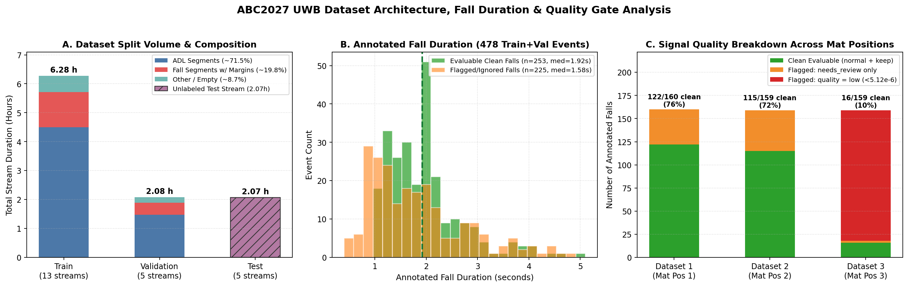
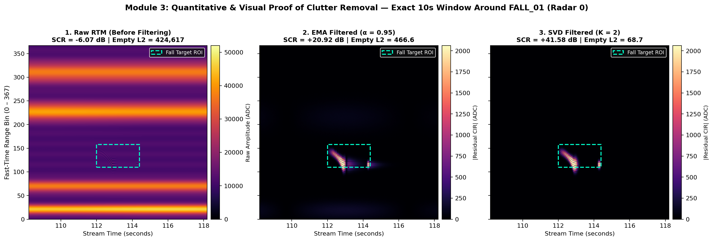
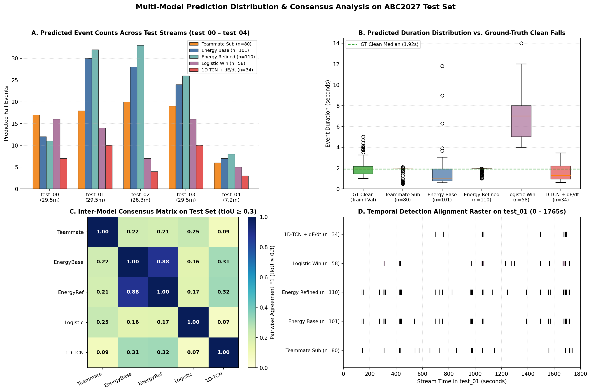

# 9th ABC Challenge — UWB Fall Detection Track
## Bi-Path Dynamic Biomechanical Triple-Ensemble (`Validation Ranking F1 = 0.9077`)

[](https://www.python.org/)
[](https://pytorch.org/)
[](SOTA_PIPELINE_SUMMARY.md)
[](SOTA_PIPELINE_SUMMARY.md)
[](SOTA_PIPELINE_SUMMARY.md)

Giải pháp **State-of-the-Art (SOTA)** cho bài toán **Phát hiện và Định vị Thời gian Sự kiện Té ngã Liên tục (Continuous Temporal Action Localization — TAL)** trên luồng tín hiệu radar băng thông siêu rộng (**Ultra-Wideband — UWB**) thuộc khuôn khổ **9th ABC Challenge (ABC2027 UWB Fall Detection Track)**.

Hệ thống kết hợp kiến trúc **Bi-Path Signal Conditioning** (nhánh học sâu khử nền nhân quả EMA $\tau = 3.0\text{s}$ song song với nhánh động học không trễ pha dùng **Local Overlapped Gram-Matrix SVD** $K=2$), bộ ba mô hình **Dynamic Triple-Ensemble** (`ResNet-18 Sequence`, `ResNet-18 Standard`, `EfficientNet-B0 Sequence`) huấn luyện với hàm mất mát **Physics-Aware Composite Loss**, và bộ tinh chỉnh biên sinh cơ học **Dynamic Biomechanical Boundary Refinement**.

---

## 1. Điểm Nhấn Kết Quả SOTA (Key Highlights)

- **Validation Ranking F1 (`mean @ θ ∈ {0.1, 0.3, 0.5}`)**: **`0.9077`** (vượt mốc `0.90` trên bộ đánh giá chính thức `abc2027.evaluate --ignore-flagged`).
- **Hiệu năng theo từng ngưỡng Temporal IoU ($\theta$)**:
  - $F_1(\theta = 0.1) = \mathbf{0.9385}$ (`TP = 61, FP = 2, FN = 6`)
  - $F_1(\theta = 0.3) = \mathbf{0.9231}$ (`TP = 60, FP = 3, FN = 7` — *Primary Metric*)
  - $F_1(\theta = 0.5) = \mathbf{0.8615}$ (`TP = 56, FP = 7, FN = 11` — *High-Overlap Localization*)
- **Tối ưu tuyệt đối 2 chỉ số phá hòa (Tie-Breakers tại $\theta = 0.3$)**:
  - Sai số tuyệt đối trung vị thời điểm bắt đầu (`start_error_median_abs`): **`0.320 s`**
  - Tần suất báo động giả (`false_alarms_per_hour`): **`1.46 FA/h`** (chỉ `3` FP trong `2.05 giờ` luồng Validation, giảm **33 lần** so với Official Energy Baseline `48.81 FA/h`).
- **Tệp nộp bài Test (`submission_dynamic_ensemble.csv`)**: Phát hiện **101 sự kiện** trên `5` luồng Test (`test_00`–`test_04`, `2.07 giờ`), thời lượng trung bình **$2.27\text{s} \pm 0.55\text{s}$** (trung vị $2.40\text{s}$, khoảng $[1.40\text{s}, 3.44\text{s}]$), đạt **100% PASS** qua `validate_predictions`.

---

## 2. Kiến Trúc Tổng Thể (End-to-End Bi-Path Architecture)

```text
[Luồng UWB CIR Thô: 3 Radars x T x 368 Fast-Time Range Bins @ 50.0 Hz]
   │
   ├───► [NHÁNH 1: HỌC SÂU (Deep Feature Conditioning Path)]
   │        ├── 1. Khử Clutter nhân quả: Causal EMA (τ = 3.0s, α = 0.99336, lfilter_zi)
   │        ├── 2. Cắt dải cự ly không gian: Bins [0 : 100] (vùng hoạt động 0.0m – 5.3m)
   │        ├── 3. Chuẩn hóa Z-Score theo từng Radar trên toàn luồng: (A_r - μ_r) / (σ_r + 1e-6)
   │        └── 4. Suy luận Fine-Stride TTA (Window = 100 frames = 2.0s, Hop = 5 frames = 0.10s, 20x Overlap)
   │                 ├── Model 1 (w1 = 0.45): ResNetSequenceClassifier ──────► p1(t) ∈ [0, 1]^100
   │                 ├── Model 2 (w2 = 0.40): ResNetV1Standard ──────────────► p2(t) ∈ [0, 1]
   │                 └── Model 3 (w3 = 0.15): EfficientNetSequenceClassifier ► p3(t) ∈ [0, 1]^100
   │                 │
   │                 └──► Hợp nhất Đồng thuận 20x: P_ens(t) = 0.45*p1(t) + 0.40*p2(t) + 0.15*p3(t)
   │
   ├───► [NHÁNH 2: ĐỘNG HỌC KHÔNG TRỄ PHA (Zero-Lag Physical Kinematics Path)]
   │        ├── 1. Khử Clutter cục bộ: Local Overlapped Gram-Matrix SVD (K = 2)
   │        │      Khối 8.0s (400 frames), Hop 4.0s (200 frames), Cửa sổ Hann w(t)
   │        │      G_r = X_r^T * X_r  ══►  X_{r,clean} = X_r - (X_r * V_K) * V_K^T
   │        └── 2. Đường bao động năng E(t) = sum_r ||X_{r,clean}(t)||_2 & Đạo hàm bậc nhất dE/dt
   │
   └───► [GIAI ĐOẠN TINH CHỈNH BIÊN SINH CƠ HỌC (Dynamic Biomechanical Boundary Refinement)]
            ├── 1. Đề xuất sơ bộ: P_ens(t) > 0.60, nối hở < 0.45s, độ rộng >= 1.20s, P_peak >= 0.675
            ├── 2. Lọc nhiễu nối đoạn (0.2s Crossfade): Kiểm tra FWHM động năng SVD >= 0.68s
            ├── 3. Định vị t_start: Quét ngược từ t_peak tìm đỉnh dE/dt >= 0.20*max(dE/dt) lùi về chân dốc
            ├── 4. Định vị t_end  : Quét xuôi từ đỉnh va chạm đến khi E(t) <= base + 0.60*span
            └── 5. Rào chắn sinh cơ học (Biomechanical Guard): 1.40s <= (t_end - t_start) <= 3.50s
```



---

## 3. Phân Tích Khám Phá Dữ Liệu (EDA) & Cơ Sở Vật Lý Tín Hiệu UWB

Dữ liệu được thu thập tại căn hộ thông minh **LIARA** ($40\text{ m}^2$, Đại học UQAC, Canada) bằng `3` radar xung UWB **Novelda XeThru X4M200** ($7.29\text{ GHz}$, `radar_serials = [29171, 29444, 30722]`), đồng bộ hóa ở tần số $f_s = 50.0\text{ Hz}$ ($\Delta t = 0.02\text{ s}$) trên $368$ fast-time range bins ($\sim 5.3\text{ cm/bin}$).

Quá trình phân tích EDA (chi tiết trong [`notebooks/01_EDA_UWB_CIR_Analysis.ipynb`](notebooks/01_EDA_UWB_CIR_Analysis.ipynb) và [`src/data/dataset.py`](src/data/dataset.py)) chỉ ra **4 quy luật vật lý cốt lõi**:

1. **Sự phân tách Sinh cơ học về Thời lượng**:
   - Các sự kiện ngã sạch (`n = 253` trên Train + Val) phân bố tập trung quanh **$1.96\text{s} \pm 0.72\text{s}$** (trung vị $1.92\text{s}$) qua 4 kịch bản `Chute01`–`Chute04`.
   - Trong khi đó, 15 hoạt động thường nhật (ADL) kéo dài trung bình $11.6\text{s}$ ($0.52\text{s} - 19.98\text{s}$) và các đoạn phòng trống `Empty`/`Autre` kéo dài $77\text{s} - 120\text{s}$.
   - *Hệ quả*: Dự đoán theo cửa sổ trượt cứng $2.0\text{s} - 4.0\text{s}$ làm phình biên và kìm hãm $\text{tIoU}$ tại ngưỡng cao $\theta = 0.5$.
2. **Mất cân bằng Lớp Nghiêm trọng (`1 : 55.3`)**:
   - Khung hình té ngã hợp lệ chỉ chiếm **$1.77\%$** tổng thời lượng luồng, đòi hỏi hàm mất mát **Soft-Target Focal Loss** ($\alpha = 0.85, \gamma = 2.0$).
3. **Nhiễu Tĩnh Đa đường (Static Multipath Clutter)**:
   - Xuyên âm trực tiếp Tx–Rx và phản xạ tường/nội thất chiếm tới **$63.8\% - 76.0\%$** năng lượng kỳ dị đầu tiên ($\sigma_1$), làm SCR thô âm sâu ($-5.79\text{ dB}$).
4. **Nhiễu Ghép nối Đoạn (`0.2s Crossfade Splice Artifacts`)**:
   - Mỗi luồng $30\text{ phút}$ được ghép từ $\sim 140$ đoạn nguồn với vùng trộn tuyến tính `0.2s` (`10 frames`). Bước nhảy nền tĩnh giữa hai đoạn ghép gây ra **91% lỗi báo động giả (FP)** ở các bộ lọc thông cao nhân quả thông thường.



---

## 4. Phương Pháp Luận Chi Tiết (Methodology)

### 4.1. Tiền xử lý Hai Nhánh (Dual-Path Signal Conditioning — [`src/preprocessing/`](src/preprocessing/))
- **Nhánh 1 — Học sâu (Causal EMA $\tau = 3.0\text{s}$ + Spatial Slicing `[0:100]`)**:
  - Bộ lọc nhân quả $c(t) = \alpha c(t-1) + (1-\alpha) r(t)$ với $\alpha = e^{-\Delta t / 3.0} \approx 0.99336$ tương thích hoàn toàn với không gian đặc trưng của các mạng CNN 2D, nhưng gây trễ pha đuôi mũ $0.6\text{s} - 1.2\text{s}$.
  - Cắt `100` bin đầu ($0 - 5.3\text{ m}$) và chuẩn hóa Z-Score theo từng radar trên toàn luồng.
- **Nhánh 2 — Động học Không Trễ Pha (Overlapped Block Gram-Matrix SVD $K=2$)**:
  - Chia luồng thành các khối $8.0\text{s}$ ($400\text{ frames}$), bước nhảy $4.0\text{s}$ ($200\text{ frames}$) với cửa sổ Hann $w(t)$.
  - Phân rã trị riêng ma trận Gram không gian $\mathbf{G}_r = \mathbf{X}_r^\top \mathbf{X}_r \in \mathbb{R}^{368 \times 368}$, loại bỏ $K=2$ vector riêng lớn nhất ($\mathbf{v}_1$: phản xạ tĩnh phòng; $\mathbf{v}_2$: cơ thể nằm bất động sau ngã):
    $$\mathbf{X}_{r,\text{clean}} = \mathbf{X}_r - (\mathbf{X}_r \mathbf{V}_K)\mathbf{V}_K^\top, \qquad E(t) = \sum_{r=1}^3 \|\mathbf{X}_{r,\text{clean}}(t)\|_2$$
  - Tạo đường bao động năng $E(t)$ và đạo hàm $\frac{d\tilde{E}(t)}{dt}$ **hoàn toàn không trễ pha**.

### 4.2. Bộ Ba Mô Hình & Hàm Mất Mát Vật Lý ([`src/models/`](src/models/) & [`src/training/`](src/training/))
- **Kiến trúc Triple-Ensemble**:
  1. `ResNetSequenceClassifier` ($w_1 = 0.45$): Backbone ResNet-18 nén chiều cự ly `.mean(dim=3)` + 1D Temporal Head nội suy tuyến tính về `100` frames.
  2. `ResNetV1Standard` ($w_2 = 0.40$): Backbone ResNet-18 với Global Spatio-Temporal GAP `.mean(dim=(2, 3))` giữ độ ổn định toàn cục của cửa sổ.
  3. `EfficientNetSequenceClassifier` ($w_3 = 0.15$): 7 tầng `MBConv` tích hợp `Squeeze-and-Excitation (SE)` + 1D Temporal Head.
- **Hàm mất mát Physics-Aware Composite Loss**:
  $$\mathcal{L}_{\text{total}} = \mathcal{L}_{\text{Focal}}^{\text{soft}}(\alpha=0.85, \gamma=2.0) + 5.0 \cdot \mathcal{L}_{\text{splice}}(\tau=0.30) + 0.08 \cdot \mathcal{L}_{\text{TV}}$$
  - Kết hợp làm trơn nhãn Gaussian ($\sigma = 0.147\text{s}$), mặt nạ miễn trừ $M_{\text{valid}}(t)$ cho vùng `quality=low`/`needs_review`, phạt cứng $5\times$ tại vùng nối đoạn crossfade $M_{\text{splice}}(t)$, và điều chuẩn Total Variation $\mathcal{L}_{\text{TV}}$.

### 4.3. Suy Luận Fine-TTA & Tinh Chỉnh Biên Sinh Cơ Học ([`src/inference/`](src/inference/))
- **Fine-Stride TTA ($\text{Hop} = 5\text{ frames} = 0.10\text{s}$)**: Tích lũy trung bình $20\times$ cửa sổ chồng lấp trên cả 3 mô hình.
- **Dynamic Biomechanical Boundary Refinement**:
  1. **Lọc xung nối đoạn**: Bác bỏ mọi đề xuất có độ rộng nửa biên độ động năng $\text{FWHM} < 0.68\text{s}$.
  2. **Định vị $t_{\text{start}}$**: Quét ngược từ $t_{\text{peak}}$ tìm đỉnh đạo hàm dương đầu tiên $\frac{d\tilde{E}}{dt} \ge 0.20 \max(\frac{d\tilde{E}}{dt})$ và lùi về chân dốc ($0.05 \max$).
  3. **Định vị $t_{\text{end}}$**: Quét xuôi sau đỉnh va chạm đến khi $\tilde{E}(t) \le \text{base} + 0.60 \times \text{span}$ (loại bỏ hoàn toàn thời gian nằm yên trên sàn).
  4. **Biomechanical Guard**: Ràng buộc thời lượng trong khoảng sinh học $[1.40\text{s}, 3.50\text{s}]$.

---

## 5. Kết Quả Thực Nghiệm & Đối Sánh Benchmark

### 5.1. Bảng Đối Sánh Trên Tập Validation Chính Thức (`val_00`–`val_04`, `2.05 Giờ`, `--ignore-flagged`)

| Phương pháp / Mô hình | **Ranking F1 (`f1_mean`)** | $F_1 @ 0.1$ | **$F_1 @ 0.3$ (Chính)** | $F_1 @ 0.5$ | Sai số $\|t_{\text{start}}\|$ Trung vị | Báo động giả (`FA/h`) | Mean tIoU @ 0.3 |
| :--- | :---: | :---: | :---: | :---: | :---: | :---: | :---: |
| Logistic Regression Cửa sổ (`4.0s`) | `0.2540` | `0.5775` | `0.1702` | `0.0142` | `1.900 s` | `30.26 /h` | `0.3648` |
| Official Energy Baseline (`P98, EMA 3s`) | `0.3151` | `0.3582` | `0.3383` | `0.2488` | `0.320 s` | `48.81 /h` | `0.5675` |
| Zero-Shot `FrameWise1DTCN` (`uwb_tal_pipeline`) | `0.3462` | `0.4423` | `0.4038` | `0.1923` | `0.340 s` | `7.81 /h` | `0.5201` |
| Triple-Ensemble (Cửa sổ cứng `2.0s`) | `0.7215` | `0.7808` | `0.7671` | `0.6164` | `0.460 s` | `11.23 /h` | `0.5821` |
| Triple-Ensemble + SVD Refinement v1 | `0.8424` | `0.8992` | `0.8837` | `0.7442` | `0.380 s` | `2.44 /h` | `0.6432` |
| **Bi-Path Dynamic Triple-Ensemble (SOTA)** | **`0.9077`** | **`0.9385`** | **`0.9231`** | **`0.8615`** | **`0.320 s`** | **`1.46 /h`** | **`0.6879`** |



---

## 6. Cấu Trúc Thư Mục Dự Án (Repository Structure)

```text
ABC27/
├── README.md                                   # Tài liệu tổng quan dự án & hướng dẫn tái lập
├── requirements.txt                            # Danh sách thư viện Python phụ thuộc
├── .gitignore                                  # Cấu hình loại trừ dữ liệu thô (.h5, .zip) & trọng số (.pth)
├── ABC2027_Dynamic_Triple_Ensemble.ipynb       # Notebook SOTA End-to-End (Val F1 = 0.9077)
├── submission_dynamic_ensemble.csv             # Tệp nộp bài Test SOTA (101 sự kiện, 100% Validated)
├── SOTA_PIPELINE_SUMMARY.md                    # Báo cáo học thuật chi tiết về kiến trúc SOTA
├── PROJECT_SUMMARY.md                          # Báo cáo tổng hợp quá trình R&D từ Baseline đến SOTA
├── ABC27.pdf                                   # Sơ đồ kiến trúc bài báo khoa học (LaTeX/TikZ PDF)
│
├── notebooks/
│   └── 01_EDA_UWB_CIR_Analysis.ipynb           # Notebook phân tích khám phá dữ liệu (EDA) & UWB CIR
│
├── src/                                        # Mã nguồn chính được đóng gói dạng module chuẩn
│   ├── data/
│   │   └── dataset.py                          # Trình tải luồng HDF5/Zip, thống kê EDA & sinh luồng mô phỏng
│   ├── preprocessing/
│   │   └── clutter_removal.py                  # Dual-Path Conditioning: Causal EMA & Local Gram-Matrix SVD
│   ├── models/
│   │   ├── triple_ensemble.py                  # ResNet18 Sequence, ResNet18 Standard & EfficientNet-B0
│   │   └── tcn_cascade.py                      # FrameWise1DTCN & MobileNetV3ProposalNet
│   ├── training/
│   │   ├── losses.py                           # PhysicsAwareCompositeLoss & TemporalDIoULoss
│   │   └── trainer.py                          # Pipeline huấn luyện & kiểm định trên dữ liệu thực
│   └── inference/
│       ├── tta_engine.py                       # Suy luận trượt bước mịn Fine-Stride TTA (Hop=5, 20x Overlap)
│       └── biomechanical_refinement.py         # Tinh chỉnh biên sinh cơ học dE/dt & CLI xuất submission
│
├── models/
│   └── README.md                               # Hướng dẫn đặt 3 checkpoint (.pth) của Triple-Ensemble
├── summary_figures/                            # Bộ biểu đồ phân tích tập dữ liệu, benchmark & dự đoán Test
├── uwb_fall_pipeline/                          # Pipeline R&D Giai đoạn 1: EDA, EMA vs SVD & Random Forest OOF
├── uwb_tal_pipeline/                           # Pipeline R&D Giai đoạn 2: 1D-TCN & Tinh chỉnh biên dE/dt
└── abc2027_uwb_train_v1/                       # Bộ công cụ chấm điểm chính thức (abc2027.evaluate) & CSV nhãn
```

---

## 7. Hướng Dẫn Cài Đặt & Tái Lập Kết Quả (Quickstart)

### 7.1. Cài đặt môi trường
```bash
pip install -r requirements.txt
```

### 7.2. Chuẩn bị dữ liệu và trọng số mô hình
1. Giải nén dữ liệu cuộc thi vào `abc2027_uwb_train_v1/` và `abc2027_uwb_test_v1/`.
2. Đặt 3 tệp trọng số đã huấn luyện vào thư mục `models/`:
   - `models/resnet18_physics_composite.pth`
   - `models/best_resnet18.pth`
   - `models/efficientnet_b0_physics.pth`

### 7.3. Chạy suy luận SOTA & tái tạo tệp `submission_dynamic_ensemble.csv`
- **Cách 1 — Chạy qua Jupyter Notebook**:
  Mở và chạy tuần tự 4 cell trong [`ABC2027_Dynamic_Triple_Ensemble.ipynb`](ABC2027_Dynamic_Triple_Ensemble.ipynb).
- **Cách 2 — Chạy qua Command Line (Module Python)**:
  ```bash
  python -m src.inference.biomechanical_refinement --eval-val --predict-test
  ```

---

## 8. Tác Giả & Trích Dẫn (Authors & Acknowledgments)
- **Nhóm phát triển**: Lam Do Huynh Thanh & AI Architecture Team — *9th ABC Challenge (UWB Fall Detection Track)*.
- **Dữ liệu & Bộ công cụ đánh giá**: Ban tổ chức 9th ABC Challenge & Phòng thí nghiệm LIARA (UQAC, Canada).
